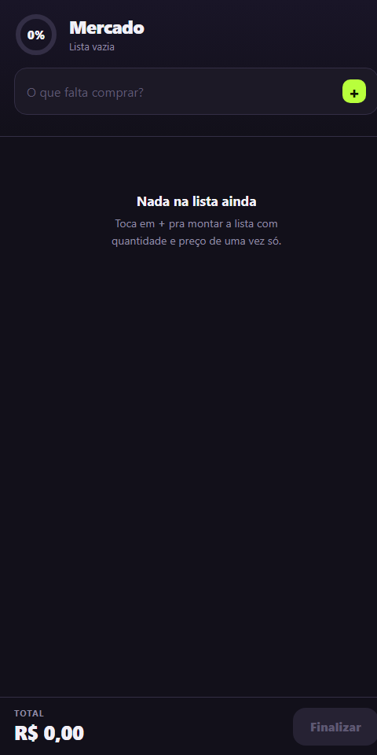

# lista-mercado-app

App Android de lista de compras com quantidade, preço e total da compra em tempo real.

App Android de lista de compras: anota o que falta, a quantidade e o preço, e acompanha o total e o progresso enquanto passa pelos corredores.

## O que faz
- Lista com quantidade e preço por item, total em tempo real e anel de progresso.
- Dados salvos no aparelho (localStorage), funciona sem internet.
- Vibração ao marcar itens (Capacitor Haptics).

## Stack
HTML, CSS e JavaScript puro, empacotado como app Android com Capacitor.

## Rodar
Abra `www/index.html` no navegador, ou gere o app: `npm install && npx cap sync android && npx cap open android`.

---
Feito por [Gabriel Ferreira](https://github.com/GABRIELFERR9).
